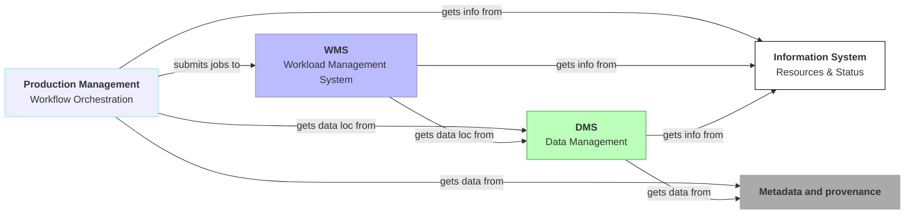
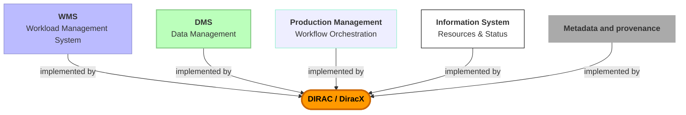
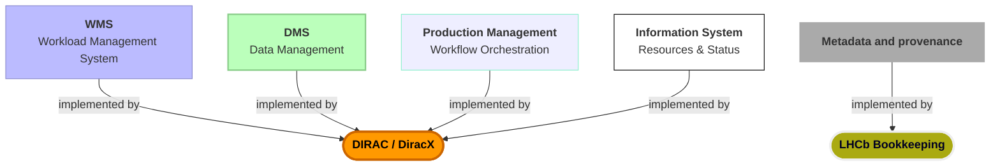
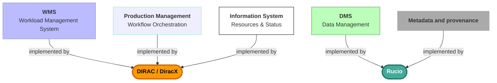
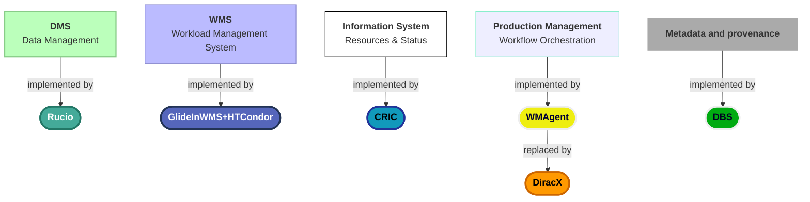
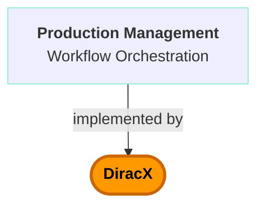

# DiracGrid software stacks
## Status, DiracX updates and plans

**Federico Stagni** <Email v="federico.stagni@cern.ch" />

DiracGrid Technical Coordinator

 

26–30 October 2026, IN2P3 Computing Centre, Lyon

<a href="https://indico.cern.ch/event/1628935/" class="ns-c-iconlink"><mdi-open-in-new />indico.cern.ch/event/1628935</a>

---
layout: top-title-two-cols
color: diracx-light
align: cm-lm-lm
title: diracgrid
columns: is-8
class: cols-split
---

:: title ::

# What is DiracGrid, actually?

:: left ::

An "**interware**" (a tool for doing distributed computing), started within LHCb 25 years ago (!).

Today used by a few dozens communities, for managing **jobs** (via pilots), **data**, **productions**, **dataset transfers**, ...

 

ATM the DiracGrid project develops and maintains 2 whole software stacks:
- [DIRAC](https://github.com/DIRACGrid/DIRAC) (the "legacy" workhorse) (+Web)
- [DiracX](https://github.com/DIRACGrid/diracx) (DIRAC's cloud-native rethink+rewrite)

  
  →
  

:: right ::

## Community

 

The [12th Dirac(X) Users' Workshop](https://indico.cern.ch/event/1588323/) was just held, 13–16 October 2026 in Prague

 

<AdmonitionType type=info>
Apart from the regular zoom meetings, we meet at <strong>3 hackathons per year</strong>, plus one <strong>workshop</strong>
</AdmonitionType>

---
layout: top-title
color: gray-light
align: c
title: core-functionalities
clicks: 4
---

:: title ::

## Core functionalities and tools (enormous simplification)

:: content ::

<v-switch>
<template #0>

### **Core functionalities**

 

 
 

### **Tools** (subset of the existing ones)

 

</template>
<template #1>

# **JUNO**, **GridPP**
Small-medium installations that want an all-in-one system

 
 

 

Old DIRAC was largely monolithic. DiracX emphasizes modularity and well-defined APIs.

</template>
<template #2>

# **LHCb**
Not a small installation, but the oldest and carrying legacy.

 
 
 

</template>
<template #3>

# **Belle2**, **CTAO**, and **FCC**
The need for modularity comes also from existing DIRAC installations

 
 
 

</template>
<template #4>

# **CMS**
For CMS, modularity is a must.

 
 

</template>
</v-switch>

---
layout: top-title
color: diracx-light
align: cm
title: since-last-year
---

:: title ::

# Since the last Rucio workshop

:: content ::

In the past year (since the 8th Rucio Community Workshop):

- **CMS and FCC joined the effort** (summer 2026) – bringing new requirements, scale, and energy to the project
- **New development process** adopted since January 2026
  - SCRUM-based, with 2-week sprints and regular checkpoint meetings
- **ADRs for everything** – Architecture Design Records guide every major decision before code is written
  - Transparent, reviewable, community-driven design process

 

---
layout: top-title-two-cols
color: diracx-light
align: cm-lm-lm
title: dev-model
columns: is-8
---

:: title ::

# The development model

:: left ::

**Large changes** start with a **proof of concept**, then an **ADR** that the other developers approve (ADRs and roadmap are public)

*"Individuals and interactions over processes and tools": the process is a guide, not a rule, and it adapts as we learn.*

From "**DiracX developments: directions**" · A. Boyer · <a href="https://indico.cern.ch/event/1588323/contributions/7301774/">DUW12</a>

:: right ::

**SCRUM since 21 January 2026**
- 2-week sprints; planning and refinement in a weekly `DDev` meeting
- Monthly `DOps` meeting with the community representatives: where use cases are shared, and priorities agreed

---
layout: top-title
color: diracx-light
align: cm
title: numbers
---

:: title ::

# The project in numbers

:: content ::

- **36 contributors** since the last workshop (10 to 18 in any given month, almost all part-time: about 5–6 FTEs in total, LHCb core developers included)
- **634 pull requests** merged across all DIRACGrid repositories since the last workshop (367 DIRAC, 261 DiracX), from **9 communities**; 17 new contributors
- The backlog is **shrinking**: 295 → 195 open issues since January 2026, with ~37 issues closed per month

 

- Known bottlenecks: **specification** and **review** (two people give three quarters of first reviews)
  - clear ADRs with scenario tests are what an implementer (human or AI agent) needs

From "**DiracX developments: directions**" · A. Boyer · <a href="https://indico.cern.ch/event/1588323/contributions/7301774/">DUW12</a>

---
layout: top-title
color: diracx-light
align: cm
title: ai-landscape
---

:: title ::

# AI is changing the landscape (also) for us

:: content ::

<AdmonitionType type='citation'>
<em>"AI's primary role in software development is that of an amplifier."</em> -- DORA 2025, State of AI-assisted Software Development
</AdmonitionType>

- **Writing code got cheap**: spikes and proofs of concept are easier to try than ever
- But **deciding what to build, and checking it, did not get cheaper**
  - It does not change our process: it shows its weak points sooner
- Vague specification → verbose, AI-generated issues that go stale
- The **review bottleneck** grows: more code means more to read, by the same two people

From "**DiracX developments: directions**" · A. Boyer · <a href="https://indico.cern.ch/event/1588323/contributions/7301774/">DUW12</a>

---
layout: section
color: diracx
title: dms
---

# DiracX developments

---
layout: top-title-two-cols
color: diracx-light
align: cm-lm-lm
title: not-a-port
columns: is-8
---

:: title ::

#  Not a port: a **reimplementation**

:: left ::

**Future clients**
- A DMS: a DIRAC client calls DiracX instead of DIRAC, over the same databases
- RSS: the read side is already in DiracX; DIRAC's adapter is in review

**A new data model**
- The spine: **workgraph**, **transformations**, **parcels**
- New requirements need new tables and new logic; DIRAC's WMS is used as it is, as a backend

From "**DiracX developments: directions**" · A. Boyer · <a href="https://indico.cern.ch/event/1588323/contributions/7301774/">DUW12</a>

:: right ::

---
layout: two-cols-title
color: diracx
align: cm-cm-cm
title: ts
columns: is-5-7
---

:: title ::

# The DiracX Transformation System

:: left ::

:: right ::

## The actual "Production" (Workflow) System

---
layout: top-title-two-cols
color: diracx-light
align: cm-lm-lm
title: ts-what
columns: is-6
---

:: title ::

# Transformation System: what it is (and what it is not)

:: left ::

<AdmonitionType type='important' >
Not the DIRAC Transformation System with a new coat of paint: same underpinnings and lessons learned, but a different shape.
</AdmonitionType>

- **One system where DIRAC had three**: Transformation, Production, and the "job" half of the WMS
- **Not** only for centrally-run activity: "user jobs" change too
- All in the ADRs: [DX-ADR-002 → 009](https://diracx.diracgrid.org/en/latest/adr/), with [explanations](https://diracx.diracgrid.org/en/latest/user/explanations/transformation-system/) and a [playground](https://diracx.diracgrid.org/en/latest/playground/)

From "The DiracX Transformation System" · C. Burr · <a href="https://indico.cern.ch/event/1588323/contributions/7264643/">DUW12</a>

:: right ::

DIRAC's WMS is two distinct abstractions, and DiracX pulls them apart:

- **Pilots** (getting hold of resources) → Compute Backends
- **Jobs** (describing the work to run) → Transformation System

---
layout: top-title-two-cols
color: diracx-light
align: cm-lt-lt
title: ts-model
columns: is-3
---

:: title ::

# Transformation System: the model

:: left ::

> A **workgraph** is a directed acyclic graph of **transformations**. Each transformation maintains a pool of **inputs**: a **feeder** tops up the pool from the experiment's metadata catalogue, a **packer** groups pooled inputs into **parcels**, and a **dispatcher** hands each parcel to a compute or data **backend**, which executes it as a job or a request. -- DX-ADR-002

From "The DiracX Transformation System" · C. Burr · <a href="https://indico.cern.ch/event/1588323/contributions/7264643/">DUW12</a>

:: right ::

- **Workgraph**: the entire thing, what DIRAC called a *production*; its status is constrained by its members'
- **Transformation**: applies *one* operation to a pool of inputs; **compute** (runs jobs) or **data** (runs requests: copy or remove replicas)
- **Inputs**: processed *exactly once, or not at all* (`Unassigned` → `Assigned` → `Processed`)
- **Feeder**: external ones bring work in from outside (metadata queries, run ranges, seeds) – *your catalogue plugs in here*; internal ones follow the graph edges
- **Packer**: groups inputs into parcels (~3 GB, ...); a parcel is **never retried**: failures send its *inputs* back to the pool
- **Dispatcher**: chooses the backend (native pilots, HPC push, HTCondor, legacy DIRAC, ...); user jobs take the same path

---
layout: top-title
color: diracx-light
align: cm
title: ts-pictures
---

:: title ::

# Transformation System: the model, in pictures

:: content ::

  
  

The two generic workgraphs (data processing: *process + merge*; simulation: *produce + process + merge*), and the workgraph state machine:

From "The DiracX Transformation System" · C. Burr · <a href="https://indico.cern.ch/event/1588323/contributions/7264643/">DUW12</a>

---
layout: iframe

# the web page source
url: https://diracx.diracgrid.org/en/latest/playground/
---

---
layout: top-title
color: diracx-light
align: cm
title: ts-backends
---

:: title ::

# One Transformation System, many compute backends

:: content ::

- Parcels are dispatched to **pluggable compute backends**: native pilots, push to HPC, **HTCondor**, legacy DIRAC, ...
- Validated by the **CMS use case**:
  - CMS keeps **HTCondor + GlideinWMS** as its submission infrastructure: one way in for Grid, HPC, GPU, ARM and Analysis Facilities; scheduling features (quotas, partitioning, data-aware matchmaking); proven at scale (800k running and 1M queued jobs); shared with more than 20 experiments
  - The **DiracX Transformation System provides the workflow management** – Tier 0, Production, Analysis – joined to HTCondor at the **Access Points**
  - Same pool, same Access Points: the Transformation System runs **in parallel** with today's systems

<AdmonitionType type='important' >
"Change what needs changing, keep what works": a pattern of interest for any community wanting to retain its existing WMS.
</AdmonitionType>

From "The CMS use case for a non-DiracX WMS" · CMS WM team · <a href="https://indico.cern.ch/event/1588323/contributions/7264642/">DUW12</a>

---
layout: top-title
color: diracx-light
align: cm
title: ts-build
---

:: title ::

# Transformation System: building it!

:: content ::

  
  
  

---
layout: section
color: diracx
title: dms
---

# Data Management for DiracX

---
layout: top-title-two-cols
color: diracx-light
align: cm-lt-lt
title: dms-fc
columns: is-6
---

:: title ::

# Data Management: the File Catalog

:: left ::

- The `FileCatalog` class **abstracts the actual catalog** behind, and defines the interface
  - used by everything: jobs, CLI, agents, etc.
  - **multiple file catalogs** can be used together (`FCConditionParser` – LHCb does)
- The **Dirac File Catalog (DFC)**: very *POSIX-like* (directories, files, replicas), with attributes, metadata, datasets, and a security manager for permissions
  - **Multi-VO**: GridPP has implemented Multi-VO metadata (and DiracX *must* be multi-VO)

:: right ::

<AdmonitionType type='tip' >
The DFC will be in DiracX, but <strong>the form is still to be decided</strong>: it needs input from every community.
</AdmonitionType>

 
 
 

From "Data Management for DiracX" · C. Haen · <a href="https://indico.cern.ch/event/1588323/contributions/7286647/">DUW12</a>

---
layout: top-title-two-cols
color: diracx-light
align: cm-lt-lt
title: dms-se
columns: is-6
---

:: title ::

# Data Management: Storage Elements and transfers

:: left ::

- **Storage Elements**: the concepts stay (abstraction of storage endpoints, protocol resolution from LFN to URL)
- **Protocols & GFAL2**: the concepts stay; arguing for a *canonical* way to handle data access on the grid (used by DIRAC, Rucio, sites...)
- **FTS**: DIRAC is capable of third-party-copy natively (with caveats)
  - open question: delegate everything to FTS? And how do you use it (multiple instances, activities, shares)?

From these building blocks, the future plans: data popularity, storage usage reports, data placement, FC/SE consistency, analytics

:: right ::

Storage Elements, from a single endpoint to SE bases and groups:

and the protocols, from LFN to URL:

 

From "Data Management for DiracX" · C. Haen · <a href="https://indico.cern.ch/event/1588323/contributions/7286647/">DUW12</a>

---
layout: section
color: diracx
title: dms
---

# Data Management for DiracX, but with Rucio

---
layout: top-title
color: diracx-light
align: cm
title: dms-elephant
columns: is-5
---

:: title ::

# DMS for DiracX

:: content ::

<AdmonitionType type='important' >
diracx-Rucio integration is a need for some communities.
</AdmonitionType>

<AdmonitionType type='important' >
DIRAC data management capabilities are NOT going away.
</AdmonitionType>

**Where Rucio fits in DiracX:**
- As a **catalog**: it's just like another one
- As a **data movement orchestrator**: external to DiracX, triggered by the Transformation System

From "Data Management for DiracX" · C. Haen · <a href="https://indico.cern.ch/event/1588323/contributions/7286647/">DUW12</a>

---
layout: top-title-two-cols
color: diracx-light
align: cm-lt-lt
title: rucio-belle2-ctao
columns: is-6
---

:: title ::

# Rucio in production with DIRAC: Belle II and CTAO

:: left ::

**Belle II** -- Rucio at the core of data management:

- File catalog since 2021: the `RucioFileCatalog` (they do *not* use the DFC)
- Metadata catalog since 2025, replacing AMGA
- DDM (transfers, deletions, SE occupancy) driven by Rucio **subscriptions** (RAW, intermediate datasets, final products, user copies)
- DIRAC jobs upload/download via the `DataManager` + `RucioFileCatalog` plugin; users have both DIRAC and Rucio clients
- 5 TB user quota from Rucio accounting, blocking job submission when full

From "Belle II Status" · P. Gebeline · <a href="https://indico.cern.ch/event/1588323/contributions/7264817/">DUW12</a>

:: right ::

**CTAO** -- Rucio in the DPPS:

- Bulk Data Management (**BDMS**) based on Rucio, plus file/metadata catalog
- DPPS v0.9: WMS on CTADIRAC v3.2.0 / DIRAC v9.1.20, BDMS (Rucio), FTS, IAM, ...
- Production K8s deployment combining **Dirac(X) for WMS/TS and Rucio for data management**, across the 4 CTAO data centers
- Switch to DiracX starting from the first telescope (LST-1), early 2027

From "CTAO report" · CTAO DPPS team · <a href="https://indico.cern.ch/event/1588323/contributions/7264815/">DUW12</a>

---
layout: top-title-two-cols
color: diracx-light
align: cm-lt-lt
title: rucio-cms-fcc
columns: is-6
---

:: title ::

# Rucio and DIRAC side by side: CMS and FCC

:: left ::

**CMS** -- Rucio in the CMS computing stack:

- CMS runs its own WMS (HTCondor + GlideinWMS); Rucio is the DMS, DBS the metadata catalog
- The interplay between Rucio and the WMS is critical for an efficient usage of disk storage
- Plans: **Rucio, DBS, CRIC integration** in the CMS Production System evolution on DiracX

From "CMS Overview" · CMS WM team · <a href="https://indico.cern.ch/event/1588323/contributions/7264818/">DUW12</a>

:: right ::

**FCC** -- Rucio tested in parallel:

- Rucio currently separate from DIRAC: every SE has to be registered in both systems
- Used to replicate the Winter2023 campaign across several sites; more resources registered in Rucio than in DIRAC
- **DIRAC–Rucio connection to be set up** (high on the FCC next-steps list)

From "iLCDirac + FCC" · FCC team · <a href="https://indico.cern.ch/event/1588323/contributions/7264822/">DUW12</a>

---
layout: top-title
color: diracx-light
align: cm
title: how-together-X
---

:: title ::

# How DiracX and Rucio will likely work together

:: content ::

- The **DiracX–Rucio interplay was not much discussed** at DUW12: clearly something to define in the months to come.
  - The data-management discussion focused on **use cases, not technicalities** -- the input collected there will drive the future Data Management ADR for DiracX
- Nevertheless, CMS has started internal discussions about the DiracX-Rucio interplay
  - They will be extended to other interested communities
  - The DiracX-Rucio ADR will eventually be proposed based on such discussions

---
layout: top-title-two-cols
align: cm-cm-lm
color: diracx-light
columns: is-4
title: summary
---
:: title ::

# Summary

:: left ::

 </img>

:: right ::

<ul class="text-base">
  <li>DIRAC and Rucio have been used as complementary tools for exploiting distributed computing resources for a few years already.
    <ul class="text-sm">
      <li>The collaboration is meant to continue!</li>
      <li>DiracX will ease the interoperability with Rucio and/or any other tool out there</li>
      <li>Rucio as a catalog ("just like another one") or as a data movement orchestrator, triggered by the Transformation System</li>
    </ul>
  </li>
  <li>DiracX is "the neXt Dirac incarnation", ensuring the future of the widely used DIRAC.
    <ul class="text-sm">
      <li>Not a port: a reimplementation. You move one component at a time, and DIRAC is only patched meanwhile</li>
      <li>Transformation System first in line, Data Management next: the communities input will drive the future ADRs</li>
    </ul>
  </li>
</ul>

---
layout: section
color: diracx
title: Questions
---

# Questions?

---
layout: section
color: diracx
title: backup
---

# Backup

---
layout: top-title
color: diracx-light
align: cm
title: duw12-rest
---

:: title ::

# DUW12: the rest of the workshop

:: content ::

- **Deployments**: K3S for Belle2, testbed infrastructure at IN2P3, non-Kubernetes deployments
- **AI-Assisted DIRAC Deployment and Operations at IHEP**: DiracX speaks HTTP and OAuth2, so an agent can use it (via MCP)
- **Analytics for DiracX: more than a proposal** (D. Kalita, F. Stagni): towards a data-lakehouse analytics platform for DIRAC(X) ([slides](https://fstagni.github.io/2026_DUW_Analytics_DiracX/))

<AdmonitionType type='note' >
All materials are linked from the <a href="https://indico.cern.ch/event/1588323/timetable/">indico timetable</a>.
</AdmonitionType>

---
layout: top-title
color: diracx-light
align: cm
title: roadmap
---

:: title ::

# The roadmap

:: content ::

<AdmonitionType type='important' >
Priorities, not commitments. New requirements can reorder this page, and the team writes the detailed plan.
</AdmonitionType>

From "**DiracX developments: directions**" · A. Boyer · <a href="https://indico.cern.ch/event/1588323/contributions/7301774/">DUW12</a>

---
layout: top-title-two-cols
color: diracx-light
align: cm-lm-lm
title: installations
columns: is-6
---

:: title ::

# If you run an installation today

:: left ::

What you can count on:

- **DIRAC keeps running**, with security patches and performance fixes when needed
- You choose **when to switch each component**, usually at a shutdown; DIRAC and DiracX run in parallel meanwhile
- **No data migration** for anything but the transformation system, which has its own tables
- Your **extension keeps working** on DIRAC while you move
- **Increments to test**, shown at DOps whenever a sprint delivers one

From "**DiracX developments: directions**" · A. Boyer · <a href="https://indico.cern.ch/event/1588323/contributions/7301774/">DUW12</a>

:: right ::

---
layout: top-title
color: diracx-light
align: cm
title: ts-usecases
---

:: title ::

## Transformation System: does it do everything we need?

:: content ::

Everything **composes**: each use case changes only the shape of the graph, and which feeder, packer, hooks and actions are plugged in. Examples from DUW12:

- **Forking outputs**: one output, many consumers, each tracking its own progress
- **Removing replicas after N uses**: a data transformation whose packer delays each file until all consumers have processed it
- **Correlated processing**: e.g. a packer looks up each file's RAW ancestor and adds it to the parcel
- **Staging from tape**: a data transformation stages; the packer delays each file until on buffer
- **Scouting**: run on a small sample first, for resource estimation and reliability, with (possibly manual) approvals
- **Retrying and splitting**: a hook decides each failed input's fate; partially-processed inputs are split

From "The DiracX Transformation System" · C. Burr · <a href="https://indico.cern.ch/event/1588323/contributions/7264643/">DUW12</a>

---
layout: top-title
color: diracx-light
align: cm
title: how-together
---

:: title ::

# How (legacy) DIRAC and Rucio work together

:: content ::

The entry point is DIRAC's `RucioFileCatalog`, an implementation of the `FileCatalog` "abstract" class (DIRAC has few different implementations of the same class, and you can `register_file()` to more than 1 catalog at the same time)
- in DIRAC since 2021
- by now it supports *Multi VO* and *Rucio metadata*
- The synchronization between DIRAC and Rucio is done via DIRAC agents

Once the data is in the Rucio catalog, all the replication policies, 3rd party copy are handled by Rucio subscriptions and rules.

This also means that:
- Admins still update the DIRAC configuration
- No change for the download/upload from jobs: still done via DIRAC's `DataManager`

