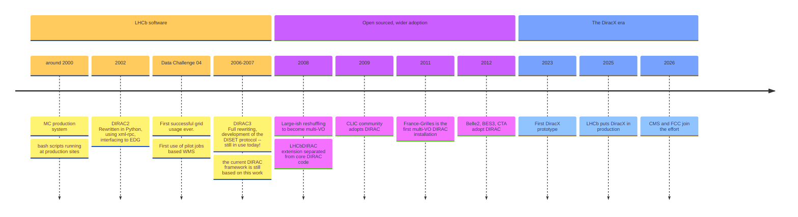
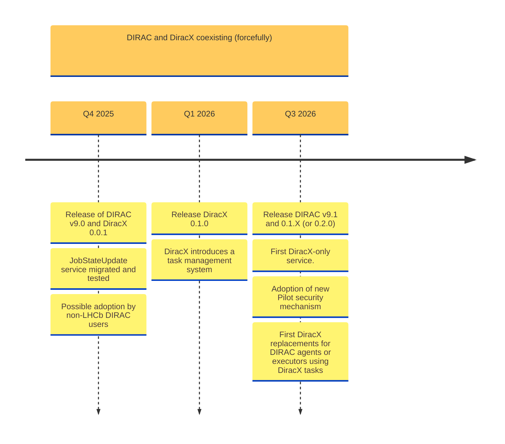

# DiracGrid software stacks
## Status, DiracX updates and plans

**Federico Stagni** <Email v="federico.stagni@cern.ch" />

DiracGrid Technical Coordinator

 

26–30 October 2026, IN2P3 Computing Centre, Lyon

<a href="https://indico.cern.ch/event/1628935/" class="ns-c-iconlink"><mdi-open-in-new />indico.cern.ch/event/1628935</a>

---
layout: top-title
color: diracx-light
align: cm
title: diracgrid
---

:: title ::

# What is DiracGrid, actually?

:: content ::

- An "**interware**" (a tool for doing distributed computing), started by LHCb
- Today used by a few dozens communities, for:
  - managing **jobs** (via pilots), **data**, **productions**, **dataset transfers**, ...
- The refurbished [diracgrid.org](https://diracgrid.org/) explains everything and has many links for your info

The DiracGrid project develops and maintains the whole software stack:
- [DIRAC](https://github.com/DIRACGrid/DIRAC) (the "legacy" workhorse)
- [DiracX](https://github.com/DIRACGrid/diracx) (the cloud-native rewrite)
- [DiracX-Web](https://github.com/DIRACGrid/diracx-web), extensions, documentation, ...

In general, DIRAC has a very active community of users and developers:
- Apart from the regular zoom meetings, we meet at **3 hackathons per year**, plus one **workshop**
- The [12th Dirac(X) Users' Workshop](https://indico.cern.ch/event/1588323/) was just held, 13–16 October 2026 in Prague

---
layout: top-title
color: diracx-light
align: cm
title: story
---

:: title ::

# The shortened Dirac's story

:: content ::

Timeline:

(full history in [this presentation](https://indico.cern.ch/event/1252369/contributions/5515343/attachments/))

---
layout: top-title
color: diracx-light
align: cm
title: since-last-year
---

:: title ::

# Since the last Rucio workshop

:: content ::

Since we met one year ago (8th Rucio Community Workshop):

- **LHCb running DiracX in production**, at scale, every day
- **CMS and FCC joined the effort** – bringing new requirements, scale, and energy to the project
- **New development process** adopted since the beginning of 2026
  - SCRUM-based, with 2-week sprints and regular checkpoint meetings
- **ADRs for everything** – Architecture Design Records guide every major decision before code is written
  - Transparent, reviewable, community-driven design process
  - [DX-ADR series](https://github.com/DIRACGrid/diracx/pulls?q=is%3Apr+is%3Aopen+label%3AADR) covers Transformation System, compute backends, CWL, and more

  
  →
  

---
layout: top-title-two-cols
color: diracx-light
align: cm-lm-lm
title: releases
columns: is-6
---

:: title ::

# Releases for the DiracGrid stacks

:: left ::

**DIRAC v9**
- v8, v9.0, v9.1
- Regular releases continue
- [github.com/DIRACGrid/DIRAC/releases](https://github.com/DIRACGrid/DIRAC/releases)

**DiracX**
- Ongoing development releases
- [github.com/DIRACGrid/diracx/releases](https://github.com/DIRACGrid/diracx/releases)

 

`v8` and `v9.0` are in maintenance mode; new features go to `v9.1` and DiracX

:: right ::

<AdmonitionType type='important' >
DIRAC and DiracX will live together for a while. One functionality at a time, we'll eventually migrate all from DIRAC to DiracX.
</AdmonitionType>

<AdmonitionType type='note' >
Business continuity for the existing user communities is our top priority.
</AdmonitionType>

---
layout: top-title
color: diracx-light
align: cm
title: hsf
---

:: title ::

# Publications, Outreach, and HSF

:: content ::

- CHEP 2026 papers on [DiracX in action](https://indico.cern.ch/event/1471803/contributions/6967106/) and [CWL](https://indico.cern.ch/event/1471803/contributions/6967104/)

**HSF Affiliated Project**
- DiracGrid is an [**HSF affiliated project**](https://hepsoftwarefoundation.org/projects/projects.html)
- Affiliation valid for 5 years (2025–2030), then reviewed for continuation

  

---
layout: section
color: diracx
title: diracx
---

# DiracX

## ...where are we, and where are we going

---
layout: side-title
side: left
color: diracx-light
titlewidth: is-4
align: rm-lm
title: what-is-diracx
---

:: title ::

# What is DiracX?

:: content ::

## A complete rewrite of DIRAC

- A cloud native app
- Multi-VO from the get-go
- Standards-based

<AdmonitionType type='important' >
Still DIRAC, in terms of functionalities.
</AdmonitionType>

- While DIRAC is already very modular, DiracX is even more
- With very well defined interfaces

---
layout: side-title
side: left
color: diracx-light
titlewidth: is-4
align: cm-lm
title: diracx-api
---

:: title ::

# DiracX APIs

:: content ::

DIRAC Web APIs with <devicon-fastapi-wordmark class="text-7xl align-middle inline-block mx-0"></devicon-fastapi-wordmark>

Nicely documented by <devicon-swagger-wordmark class="text-7xl align-middle inline-block mx-0"></devicon-swagger-wordmark>

Follows the <devicon-plain-openapi-wordmark class="text-7xl align-middle inline-block mx-1"></devicon-plain-openapi-wordmark> specification, with the (python) client generated by [AutoREST](https://github.com/Azure/autorest/blob/main/docs/introduction.md)
- clients in another language are just one pipeline away.

---
layout: top-title
color: diracx-light
align: cm
title: diracx-web
---

:: title ::

# DiracX-Web

:: content ::

We are also rewriting [the Web App](https://github.com/DIRACGrid/diracx-web) from scratch.

Software stack:

- NextJS <devicon-nextjs-wordmark class="text-4xl align-middle inline-block mx-2" />
- Material UI <devicon-materialui class="text-3xl align-middle inline-block mx-2" />
- TypeScript <devicon-typescript class="text-3xl align-middle inline-block mx-2" />

(very similar to Rucio Web UI stack)

- There is no tight coupling between API and frontend: the web app acts as any other DiracX client using the same set of endpoints.
- As per DiracX, DiracX-Web is extendable.

---
layout: top-title-two-cols
color: diracx-light
align: cm-lm-lm
title: roadmap-last-year
columns: is-7
---

:: title ::

# The roadmap as foreseen one year ago

:: left ::

:: right ::

- DiracX 0.1.0 brings "**tasks**", for replacing DIRAC's _agents_, _executors_, and the RMS machinery (the _RequestExecutingAgent_)
- DIRAC v9.1 was needed because of database changes
- Standalone DiracX will take at least 2 years from then

---
layout: top-title
color: diracx-light
align: cm
title: roadmap-status
---

:: title ::

# ...and where we are now

:: content ::

<AdmonitionType type='tip' >
The plan broadly held. Updates and adjustments below, in the workshop summary.
</AdmonitionType>

- **Tasks** are in DiracX, and being progressively rolled out to replace agents and executors
- **Transformation System**: ADRs written and discussed, implementation ongoing
- **CWL** replacing JDL as job definition language: first experiments' workflows running
- **Pilot security**: moving from X509 to tokens
- **New VOs on board**: CMS and FCC onboarding started

 

Details in the [12th Dirac(X) Users' Workshop](https://indico.cern.ch/event/1588323/) materials

---
layout: section
color: diracx
title: duw12
---

# The 12th Dirac(X) Users' Workshop

## 13–16 October 2026, FZU Prague

<a href="https://indico.cern.ch/event/1588323/" class="ns-c-iconlink"><mdi-open-in-new />indico.cern.ch/event/1588323</a>

---
layout: top-title
color: diracx-light
align: cm
title: duw12-format
---

:: title ::

# DUW12: format and participation

:: content ::

4 days, in Prague, hosted by FZU:

- The agenda had a **clear divide**: presentations in the mornings, and **discuss/hack in the afternoons** (in smaller groups)
- Main topics: DiracX directions, Transformation System ADRs, CWL, **data management**, deployments, community status reports

<AdmonitionType type='note' >
All materials are (or will be) linked from the <a href="https://indico.cern.ch/event/1588323/timetable/">indico timetable</a>.
</AdmonitionType>

---
layout: top-title
color: diracx-light
align: cm
title: duw12-diracx
---

:: title ::

# DUW12 highlights: DiracX developments

:: content ::

**DiracX developments: directions**
- Consolidation of the released stack, progressive migration of DIRAC functionalities
- "Tasks" as the replacement mechanism for agents/executors and the RMS machinery

**Transformation System ADRs**
- Presentation and Q&A of the ADR series, followed by **hands-on sessions in the afternoons**
- The TS is the workhorse of productions; its redesign for DiracX is a top priority

**CWL: what it is, and why it's fitting**
- Hands-on sessions: CWL before DiracX, then CWL for DiracX
- "CWL for the experiments' workflows": real use cases from the experiments

---
layout: top-title
color: diracx-light
align: cm
title: duw12-datamgmt
---

:: title ::

# DUW12 highlights: Data Management

:: content ::

A full morning dedicated to data management:

- **FTS, XRootD, gfal** (remote): the tools we all rely on, status and plans
- **Rucio** (remote): ongoing developments of interest to the DIRAC communities
- **Data Management for DiracX**: requirements and user stories
  - gathering what DiracX's DMS will need to do, and for whom
- **DB12: we need to talk**: the catalogue/storage space accounting database, and its future
- Afternoon: Q&A for data management, Rucio, etc.

<AdmonitionType type='important' >
For DiracX, data management comes after WMS and the Transformation System -- but requirements are being collected now. This is where the DIRAC and Rucio communities should speak up.
</AdmonitionType>

---
layout: top-title
color: diracx-light
align: cm
title: duw12-deployments
---

:: title ::

# DUW12 highlights: Deployments and operations

:: content ::

- **K3S deployments for Belle2**
- **Testbed infrastructure at IN2P3**
- **Non-Kubernetes deployments**: not everyone wants (or can) run K8s
- Q&A on deployments

Plus, from the community:

- **AI-Assisted DIRAC Deployment and Operations at IHEP**
- **RSS in DIRAC and DiracX**: the Resource Status Service, shared between the stacks
- **No certificate authentication**: the path towards tokens (goodbye X509)
- Development tips and tricks

---
layout: top-title
color: diracx-light
align: cm
title: duw12-status
---

:: title ::

# DUW12 highlights: Community status reports

:: content ::

Short reports from the communities using (or planning to use) DIRAC/DiracX:

- GridPP, Belle2, CMS, LHCb, JINR, CTAO
- iLCDirac + FCC, IHEP, EGI and GreenDIGIT
- CMS: the use case for a non-DiracX WMS, and how this affects DiracX developments

<AdmonitionType type='note' >
CMS bringing their own WMS perspective is a healthy stress test for DiracX: different requirements, same infrastructure.
</AdmonitionType>

Afternoons: "Community support" sessions for hands-on help and discussions.

---
layout: top-title
color: diracx-light
align: cm
title: duw12-takeaways
---

:: title ::

# DUW12: takeaways

:: content ::

- The **Transformation System** is the main current development focus, guided by ADRs and community input
- **CWL** is well received as the future job/workflow definition language
- **Data management requirements** for DiracX are being collected: DIRAC's DMS will stay relevant, and Rucio remains a (the?) catalog option
- **Tokens will replace X509** for authentication -- like in the rest of the (WLCG) world
- **Deployment flexibility matters**: K8s is the reference, but not the only way
- The community is **growing**: new VOs, new use cases, new ideas (including AI-assisted operations)

---
layout: side-title
side: left
color: diracx-light
titlewidth: is-5
align: cm-lm
title: dirac-rucio
---

:: title ::

  </img>  </img>

# DIRAC(X) and Rucio

:: content ::

- Few communities (Belle2, CTAO, few institutes in GridPP, ...) have been using, or will soon use, DIRAC(X) and Rucio together, with (_en-gros_):
  - DIRAC(X) as **WMS** (so, not using DIRAC's DMS)
  - Rucio as **DMS**
- There are also exploratory works on using parts of DIRAC that are not the WMS

There is also a dedicated [mattermost channel](https://mattermost.web.cern.ch/diracx/channels/rucio---dirac)

---
layout: top-title
color: diracx-light
align: cm
title: how-together
---

:: title ::

# How DIRAC and Rucio work together

:: content ::

The entry point is DIRAC's `RucioFileCatalog`, an implementation of the `FileCatalog` "abstract" class (DIRAC has few different implementations of the same class, and you can `register_file()` to more than 1 catalog at the same time)
- in DIRAC since 2021
- by now it supports *Multi VO* and *Rucio metadata*
- The synchronization between DIRAC and Rucio is done via DIRAC agents

Once the data is in the Rucio catalog, all the replication policies, 3rd party copy are handled by Rucio subscriptions and rules.

This also means that:
- Admins still update the DIRAC configuration
- No change for the download/upload from jobs: still done via DIRAC's `DataManager`

---
layout: top-title
color: diracx-light
align: cm
title: namespace
---

:: title ::

# How DIRAC and Rucio work together -- namespace

:: content ::

- By default, Rucio has a flat namespace that contains files
  - Files that can be aggregated to datasets
  - Then datasets can be aggregated to containers
- DIRAC uses a hierarchical namespace

The `RucioFileCatalog` "translates" from DIRAC to Rucio's namespace. All details in [this vCHEP presentation](https://indico.cern.ch/event/948465/contributions/4323983/attachments/2247115/3811355/The%20Rucio%20File%20Catalog%20in%20Dirac%20implemented%20for%20Belle%20II-2.pdf)

---
layout: top-title
color: diracx-light
align: cm
title: next
---

:: title ::

# What's next

:: content ::

- **Tasks** will progressively replace DIRAC agents, executors, and the RMS machinery
- **Transformation System** for DiracX, following the ADRs discussed at DUW12
- **CWL** as the way of defining jobs and workflows, replacing JDL
- **Tokens** replacing X509 for authentication
- **Data Management for DiracX**: shaping the requirements (yours are welcome!), keeping interoperability with Rucio and any other tool out there
- In general, users of both DiracX and Rucio should **drive the agenda** on what's next

<AdmonitionType type='important' >
Probably, eventually we will organize a new DiracX+Rucio mini-WS and hackathon, or something similar. Stay tuned!
</AdmonitionType>

---
layout: top-title-two-cols
align: cm-cm-lm
color: diracx-light
columns: is-4
title: summary
---
:: title ::

# Summary

:: left ::

 </img>

:: right ::

<ul class="text-base">
  <li>DIRAC and Rucio have been used as complementary tools for exploiting distributed computing resources for a few years already.
    <ul class="text-sm">
      <li>The collaboration is meant to continue!</li>
      <li>DiracX will ease the interoperability with Rucio and/or any other tool out there</li>
    </ul>
  </li>
  <li>DiracX is "the neXt Dirac incarnation", ensuring the future of the widely used DIRAC.
    <ul class="text-sm">
      <li>LHCb runs it in production; CMS and FCC are joining</li>
      <li>It will live together with DIRAC v9 for a while, until it will replace it completely</li>
      <li>WMS and Transformation System first, Data Management later -- but requirements are being collected already</li>
    </ul>
  </li>
</ul>

---
layout: section
color: diracx
title: Questions
---

# Questions?

---
layout: credits
color: diracx
loop: true
speed: 1.0
title: credits/people
---

    

        <strong>People</strong> 
    

    

        <strong>Current Developers, maintainers, supporters</strong>
    

    

        Chris Burr <i>CERN, LHCb</i> 
        Christophe Haen <i>CERN, LHCb</i> 
        Alexandre Boyer <i>CERN, LHCb</i> 
        Natthan Piggoux <i>LUPM (FR), CTA</i> 
        Cedric Serfon <i>Brookhaven National Laboratory (US), Belle2</i> 
        Ryunosuke O'Neil <i>CERN, LHCb</i> 
        Daniela Bauer <i>Imperial college (UK), GridPP</i> 
        Simon Fayer <i>Imperial college (UK), GridPP</i> 
        Janusz Martyniak <i>Imperial college (UK), GridPP</i> 
        Xiaomei Zhang <i>Beijing, Inst. High Energy Phys. (CN), Juno</i> 
        Luisa Arrabito <i>LUPM (FR), CTA</i> 
        André Sailer <i>CERN</i> 
        Jorge Lisa Laborda <i>Univ. of Valencia and CSIC (ES), LHCb</i> 
        Bertrand Rigaud <i>IN2P3 (FR)</i>
    

    

        <strong>Project lead</strong>
    

    

        Federico Stagni <i>CERN, LHCb</i> 
        Andrei Tsaregorodtsev <i>CPPM (FR), EGI and LHCb</i>
    

&nbsp;
&nbsp;
&nbsp;
&nbsp;
&nbsp;

    <strong>Thank you!</strong>

